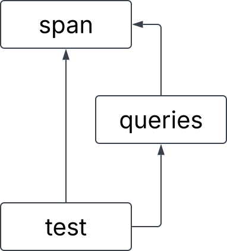

# Lab 8: Header Guards, .gitignore, and Mail
In this lab, you will organize some nostalgic files using shell scripting, write
your own `.gitignore`, and send mail messages with Pokemon. You have the entire lab period for this. Have fun!

## Lab 8 learning objectives

* Recognize the purpose of header files
* Understand the need for header guards
* Determine which files should not be tracked by Git and list them in `.gitignore`
* Trade Pokemon by sending and receiving mail on `ieng6`!

## Header Guards

```c
#ifndef EXAMPLE_H
#define EXAMPLE_H

struct example {
    char *str;
};

#endif
```

Header guards prevent the content within them from being processed multiple times by the compiler.
This can be problematic if the header file intends to *define* any symbol, not just *declare* them.
In the example above, the header guard ensures that `struct example` is defined at most once.
Let's illustrate the utility of header guards with a concrete example.

After cloning the Github classroom repository onto `ieng6`, `cd` into `headers` and inspect the contents of the five `.c` and `.h` files inside. These files together represent 3 "modules" with the following dependency graph:



When the compiler reads `test.c`, its preprocessor will process `span.h` twice: once through the direct arrow pointing to `span.h` and once through `queries.h`, which also points to `span.h`. As a result, the contents of `span.h` will be "pasted" into the source file twice. Since `span.h` contains a struct *definition* for `struct string_span`, this definition will be repeated twice. Try the following compilation command to see what this causes:

```
$ gcc span.c queries.c test.c -Wall -o test
```

The compiler seems to be confused by the duplicated definition for `struct string_span`, which is the first error it reports. 

**To Do**: Use what you have learned about header guards to fix this compiler error! Please note that by convention, everything in a header file is wrapped in a header guard.


# What should Git ignore?

You may have used the `git add .` in the past. By default, this means Git should track everything it finds in your repository directory. **But you don't always want to track everything\!** Here are a few things you shouldn't track in Git in most cases:

1. **Machine code**, such as in object files (`.o` files) and executables

   There are three reasons why you shouldn't track machine code in Git:
   * Git is inefficient at handling large binary files
   * Machine code differs from machine to machine, so they are often useless to your collaborators
   * Binary file conflicts are cumbersome—there's no way to integrate conflicts together

   As a general rule, **you should never use Git to track the outputs of a compilation or transpilation process**. In C projects with Makefiles, the targets defined in the Makefile usually represent the outputs of a compilation process.

2. **Secret credentials**

   Many hosted services have public repositories for the source code of the server. The server needs to authenticate itself to get write access to the database, for example. But the keys for such authentication cannot be public or else anyone can tamper with the database\!

3. **Most hidden files** (files whose names start with `.`, like Vim swapfiles)

   Do not track your Vim swapfile\! Imagine this: You have a terminal prompt and Vim side-by-side. Because Vim is currently running, there is a swapfile in the repository directory. You then commit and push your swapfile to GitHub. Your collaborator pulls it from GitHub without Vim running and tries to edit it with Vim. Because there's a swapfile, Vim gives them a warning, thinking that another Vim process might be editing the file simultaneously even though they don't have Vim running. This is counterproductive\!

## How do we tell Git to ignore them?

`.gitignore` is the exact name of a special file that Git reads to determine which files to skip when looking for untracked files. If a file's name matches any line in `.gitignore`, it is ignored. For example, if a `.gitignore` file contains:

```
*.o
```

Then Git should ignore all files that end with `.o`. In this context, `*` is a wildcard that matches any sequence of characters.

<div class="note">

It would be nice if we could write an expression that matches all executable files without an extension. As it turns out, we don't know of a neat way to do this. You could copy the list of targets from your Makefile as an alternative. You could also write a shell script that enumerates all the executable files and writes their names into `.gitignore`. Beware that the wildcard in Makefiles is `%`, while the wildcard in `.gitignore` files is `*`.

</div>

## What if they are already being tracked?

You may have committed and pushed these files to Git in the past. To fix this, you can have Git untrack them without removing the actual files themselves by running:

<code>
  $ git rm --cached
  <span contenteditable class="code-replace-me">path to file to untrack</span>
</code>

For example, if you have committed `stack.o` and want to untrack it without deleting it entirely, you would run `git rm --cached stack.o`.

## Write your own `.gitignore`

Some of the files in our starter repository should not have been tracked. First, **change back from `minihome` back to the root of your starter repo.** Run `ls -a` to list all the files (including hidden ones), use your best judgment to decide which ones shouldn't have been tracked, and instruct Git to untrack those files without removing them. Then, write an appropriate `.gitignore` file. To check your work, run `git status`. The files you untracked should not appear in the list of "untracked files", and when you run `git add .`, they should not become tracked again. Don't hesitate to work with your group and ask for help\!

<div class="note">

- Even though `.gitignore` is technically a hidden file, you should track `.gitignore` itself. This prevents your collaborators from tracking the files you don't want to track.
- You might have noticed the `.git` directory. This is Git's hidden workspace,
  where it stores your repository's commit history and branches. Git will
  never track `.git` by default, as this would end up requiring infinite
  space. Therefore, you don't need to put it in `.gitignore`.

</div>

<div class="checkoff">

Please write what you added to your `.gitignore` on your whiteboard.

</div>

# <a href="http://www.aolsucks.org/aolsound.htm" target="_blank">You've got Mail!</a>

The mail command, unlike other commands we’ve taught you in this lab and previous ones, is especially unique: literally no one\* uses this\! As such, this section is not relevant to any course material. But the idea of sending each other mail via the terminal, all 1970s-core, is too appealing to pass up on.

_\* By “literally no one”, I mean “literally no one, except for at least one person at this university”, so I’ve been told._

Throughout this section, we’ll use `myname` and `friendname` to refer to your and your partner’s UCSD username, respectively. This is the username you use for your UCSD email, and the one you use to log into ieng6.

In order for mail to work, you and whoever you are mailing to must be on the same cluster on ieng6. You do not need to know what a cluster is, but you do need to know how to SSH into a specific one on ieng6. If each line of your command prompt starts with this:

```
[myname@ieng6-640]:~:500$
```

Then `ieng6-640` is the cluster you are logged into. In order to SSH into a specific cluster, exit out of your current SSH session, and in your local machine terminal, type:

<code>
  $ ssh
  <span contenteditable class="code-replace-me">myname</span>@ieng6-640.ucsd.edu
</code>

And enter your password as usual. Make sure both you and your partner are on cluster 640\.

<div class="important">

In the following instructions, you will use the `mail` command, but it is not
available on the `ieng6-2xx` servers. Please make sure to **log out of `ieng6`**
and **then** sign into **`ieng6-640.ucsd.edu`**! This specific cluster runs an older
operating system that still has the `mail` command.

</div>

Once you and your partner are in the same cluster, try using the mail command to begin composing an e-mail (electronic mail). Either command below works:

```
$ mail friendname@ieng6-640.ucsd.edu
$ mail friendname@ieng6-640
```

This will prompt you with `Subject:` so you can type your email’s subject. The subject is only one line of test, so when you press Enter you are now typing the contents of your mail. When done writing your message, press `Ctrl+D` to finish and send.

Now, your partner can use the `mail` command by itself to see that they have received mail\! It will have a number next to it as it enumerates messages every time you open the mail shell. Type this number and press `Enter` to see the message.

Now that you have mail and therefore can enter the mail shell, you can type `?` to get a list of commands that you can use.

```
type <message list>          type messages
next                         goto and type next message
from <message list>          give head lines of messages
headers                      print out active message headers
delete <message list>        delete messages
undelete <message list>      undelete messages
save <message list> folder   append messages to folder and mark as saved
copy <message list> folder   append messages to folder without marking them
write <message list> file    append message texts to file, save attachments
preserve <message list>      keep incoming messages in mailbox even if saved
Reply <message list>         reply to message senders
reply <message list>         reply to message senders and all recipients
mail addresses               mail to specific recipients
file folder                  change to another folder
quit                         quit and apply changes to folder
xit                          quit and discard changes made to folder
!                            shell escape
cd <directory>               chdir to directory or home if none given
list                         list names of all available commands

A <message list> consists of integers, ranges of same, or other criteria
separated by spaces.  If omitted, Mail uses the last message typed.
```

Note that when the help dialog says “folder”, this is a bit of a misnomer. The “folder” is actually the filename that the command will use. For the `save` and `copy` commands, you can give it a valid path to a file and it will save or copy the contents of the email into the file. The path is relative to wherever you opened the mail shell.

You will likely not need to use all of these commands but at least a few are worth noting:

* `type <message list>` can be used to print out the contents of selected messages. For example, `type 3 4` prints out the contents of messages 3 and 4\.
* `headers` will print out the list of enumerated messages along with their senders, subjects, and statuses.
* You can respond to a message with `Reply <message list>`, which will open a response to the message to type in a reply. Again, you can finish and send with `Ctrl+D`. For example, `Reply 5` opens a response to message 5\.

There also exists another method to send mail from outside the mail shell, using the pipe operator we learned earlier. This command also makes use of the `echo` command, which outputs its argument to stdout. Sounds redundant, but it’s intended to be used in this way to input strings into other commands, or to be used as print statements in bash scripts.

<code>
  $ echo
  <span contenteditable class="code-replace-me">"email body here"</span>
  | mail -s
  <span contenteditable class="code-replace-me">"subject here"</span>
  <span contenteditable class="code-replace-me">friendname</span>@ieng6-640.ucsd.edu
</code>

## Trading Pokemon

We can also use email to send attachments in the form of files. In this section, we’ll trade Pokemon with each other via mail. We will use the `pokeget.sh` script provided in your lab starter code for fun to generate some files with Pokemon in them. First, let one person be the sender, and the other will be the receiver. After you can successfully send and receive Pokemon from one to the other, swap roles and try sending one the other way.

### Sender

Use the below command to generate a ".pk" file with the name of the Pokemon you picked. For example, if you picked Pikachu, \#25, you would call this file `pikachu.pk`. Alternatively, if you want the receiver to not know what the Pokemon is until they open the file, you can call it `mystery.pk`. Feel free to replace `25` with the [National Dex number](https://www.pokemon.com/us/pokedex) of any Pokemon.

```
./pokeget.sh 25 > pikachu.pk
```

If the `pokeget.sh` script seems to take more than a few seconds to finish running, try using `Ctrl + C` to interrupt the program and try running the same command again.

Once you have a ".pk" file, use the following command to send it to your partner, using the `-a` option. Replace "pikachu.pk" with the name of your Pokemon file if it is different.

<code>
  $ echo
  <span contenteditable class="code-replace-me">"email body here"</span>
  |
  mail -s
  <span contenteditable class="code-replace-me">"subject here"</span>
  -a
  <span contenteditable class="code-replace-me">pikachu.pk</span>
  <span contenteditable class="code-replace-me">friendname</span>@ieng6-640.ucsd.edu
</code>

### Receiver

Open up your mail shell with the mail command. You should have a new email if the sender did their job properly. Type the following command to save the email you received as a file, with `n` replaced by the ID number of the email. Note that the “&” is the prompt, and does not need to be typed, just like “$” in the terminal.

```
& save n pokemon.mail
```

Extracting the attachment in a readable form from the email itself is quite involved, so please use the provided script to get your Pokemon:

```
./extract_pokemon.sh pokemon.mail > pokemon.pk
cat pokemon.pk
```

<div class="note">

If you get an error running `extract_pokemon.sh` that mentions something about a bad interpreter, this is likely because the file hasn't been formatted for unix correctly yet. Run `sed -i 's/\r$//' extract_pokemon.sh` to reformat the file and try again.

</div>


If everything went well, you should get the Pokemon your partner sent you\! Have a bit of fun with this and send each other some cool Pokemon.

<div class="checkoff">

Please spend a couple minutes drawing the pokemon you received from your neighbor.
You can take turns drawing and reading through the next part.

</div>


